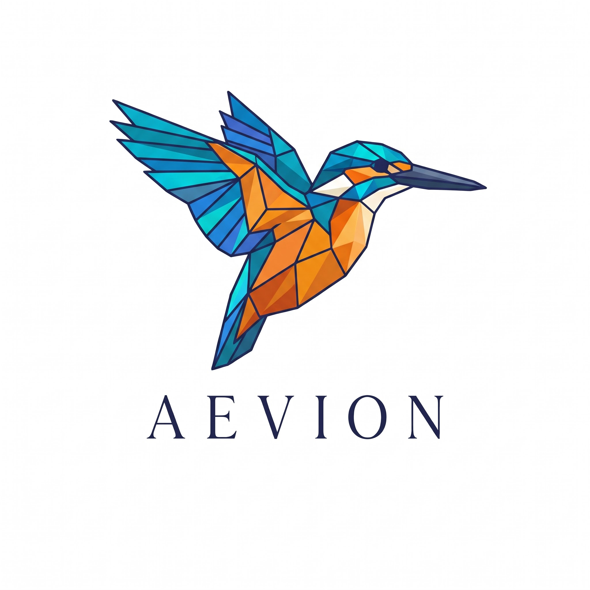

# Aevion – Ultra HD, 4K & AMOLED Wallpaper Platform

<div align="center">
  
  <p><strong>Elevate Your Screen</strong></p>
  <p>A high-performance wallpaper discovery and download platform engineered for high organic traffic, low bounce rate, and Google AdSense monetization.</p>
</div>

---

## 🌟 Key Features

### 1. User Experience & Aesthetics
- **Branded Design**: Features the official **Aevion** origami hummingbird identity with sleek dual-theme styling (Dark/OLED Black Mode & Clean Light Mode).
- **Zero-CLS Masonry Grid**: Preserves original aspect ratios with dominant-color placeholders preventing Cumulative Layout Shift.
- **Smart Filtering & Search**:
  - Filter by Device (Desktop 16:9/21:9, Mobile 9:16, Tablet, Universal).
  - Filter by Genre (AMOLED, Cyberpunk, Nature, Anime, Minimalist, Supercars, Space, Abstract).
  - Interactive Color Palette filter.
  - Live debounce auto-complete search.
- **One-Click Downloads**: Direct download without mandatory registration barriers, supporting multiple resolutions (Original 4K/8K, 1440p, 1080p, Mobile Portrait).
- **Personalization**: LocalStorage & synchronized bookmarking ("My Favorites") with animated visual feedback.

### 2. Google AdSense & SEO Optimization
- **Policy-Compliant Ad Placements**: Pre-configured ad units for Header Leaderboard, In-Feed native gallery cards, and Detail Page sidebars with clear "Advertisement" labels and fixed dimensional containers.
- **Dynamic XML & Image Sitemaps**: Pre-built routes (`/sitemap.xml` and `/robots.txt`) with Google Image Sitemap tags (`<image:image>`, `<image:loc>`) for rapid indexing on Google Images.
- **Schema.org Structured Data**: Dynamic `ImageObject` and `WebSite` JSON-LD schemas on every page.
- **AdSense Approval Ready**: Pre-written legal compliance pages (**Privacy Policy** with Google DoubleClick cookie disclosures, **Terms of Service**, **DMCA Takedown Notice & Form**, and **About Us**).

### 3. Admin Studio (`/admin`)
- **Automated Sharp Pipeline**: Multi-variant WebP thumbnail and preview generation, perceptual hash (pHash) duplicate detection, and metadata extraction.
- **Revenue Controller**: Toggle ad units, update Publisher ID (`ca-pub-XXXXXXXX`) and Slot IDs directly from the dashboard.
- **DMCA Inbox**: Review and resolve user copyright reports with single-click actions.

---

## 🚀 Quick Start Guide

### Server is Currently Running:
The platform is actively running at:
👉 **[http://localhost:5000](http://localhost:5000)**

### Admin Studio Credentials:
- **URL**: `http://localhost:5000/admin`
- **Username**: `admin`
- **Password**: `aevion@admin2026`

### Running Commands:
```bash
# Start unified full-stack server (serves API & Client)
npm start

# Run frontend development server separately (hot-reload on port 3000)
npm run client

# Run backend development server with auto-restart
npm run server

# Re-seed database with sample high-res wallpapers
npm run seed
```

---

## 📁 Project Architecture

```
wallpaper website/
├── client/                     # Frontend Application (React + Vite + Tailwind CSS)
│   ├── public/logo.png         # Aevion official brand logo
│   ├── src/
│   │   ├── components/
│   │   │   ├── common/         # Navbar, Footer, Logo, AdSlot
│   │   │   └── wallpapers/     # WallpaperCard, FilterBar
│   │   ├── context/            # ThemeContext, FavoritesContext
│   │   ├── pages/              # Home, Detail, Categories, Legal, Admin
│   │   └── App.jsx
│   └── vite.config.js
├── server/                     # Backend API (Node.js + Express + Sharp)
│   ├── src/
│   │   ├── config/db.js        # Dual MongoDB / Local JSON fallback
│   │   ├── controllers/        # Wallpapers, Categories, Admin, Ads
│   │   ├── routes/             # REST routes + SEO /sitemap.xml
│   │   ├── services/           # Sharp Image Processing & Storage
│   │   └── seed.js             # Initial 4K wallpaper library
│   └── uploads/                # Processed WebP wallpapers & thumbnails
└── package.json
```
